# CNN Breakthroughs DRFM Interference: The Intelligent Evolution Path of Radar Anti-Deceit

CNN Breaks Through DRFM Interference: The Intelligent Evolution of Radar Anti-Deceit
The core game in modern electronic warfare has long focused on the ultimate confrontation between radar's "perception" and interference's "deceit." When digital radio frequency memory (DRFM) deceived interference becomes the "number one enemy" for radar, capable of replicating radar signals and generating realistic false targets that render traditional parameterized signal processing algorithms completely ineffective, the advent of convolutional neural networks (CNN) has opened a smart breakthrough path for radar anti-interference.
From ballistic missile defense radar to conventional battlefield surveillance radar, almost all active radar systems are hard-hit by DRFM interference. This type of interference is highly cunning in its logic: intercepting the pulse signals transmitted by radar, capturing the signal characteristics through high-speed digital sampling and storage, then modulating amplitude, phase, and frequency, and re-emitting it to generate highly coherent false echoes with real targets.
These false targets will precisely appear within the radar's range gate and Doppler gate, achieving range gate masking, Doppler gate masking, joint range-Doppler masking, random masking, and even strong interference suppression, directly rendering the radar's matched filtering section "virtually useless"—since the core of matched filtering is matching the radar's transmitted signal, and the DRFM interference signal is essentially "replicated + fine-tuned," naturally easily passing this key check.
Once false targets enter the radar detection process, a chain reaction follows: the radar signal processor is forced to perform ineffective computations on a massive number of false targets, severely consuming system resources; detection performance drops dramatically, with real targets being overwhelmed by false targets; trackers are deceived, misidentifying false targets as real ones, ultimately leading to the complete paralysis of the entire radar system's combat effectiveness.
What's more challenging is that DRFM interference technology continues to evolve, from generating single false targets to dense masking of multiple targets, from fixed parameter modulation to random dynamic modulation, making traditional anti-interference methods exhausted.
In the face of DRFM interference, the shortcomings of traditional radar signal processing are exposed. For a long time, radar target detection and anti-interference have relied on parameter modeling + constant false alarm rate (CFAR) system, which is based on the strict assumption that "the signal characteristics are known and the noise distribution is stable". However, DRFM interference precisely breaks all these assumptions.
1  
Parameter model failure: The design of parameter models for DRFM interference is extremely difficult, and once the interference parameters change, the model must be re-adjusted, resulting in poor adaptability.
2  
Feature extraction relies on human intervention: The interference identification in traditional methods is highly dependent on the expertise of domain experts, and the features extracted by humans are subjective. In the face of diverse DRFM interferences, their robustness is severely lacking.
3  
CFAR detection is inadequate: although classic algorithms such as CA-CFAR can adaptively adjust the detection threshold, they are unable to effectively distinguish between DRFM false targets within the main lobe due to the high similarity of signal characteristics with true targets.
In short, the traditional "certainty" thinking of methods has long been unable to cope with the "dynamic and diversified" characteristics of DRFM interference. Radar anti-interference urgently needs an intelligent method that can learn and adapt autonomously.
One of the core outputs of radar, the range-Doppler image, becomes a key link connecting CNN and radar jamming. Real targets present clear single-point features in the range-Doppler image, while different types of DRFM interference form unique spatial distribution patterns: range gate masking presents continuous pseudo targets along the range dimension, Doppler gate masking is dense distribution in the Doppler dimension, and combined masking presents two-dimensional surface-like pseudo target characteristics.
This "feature differentiation in space" characteristic is highly consistent with the core capability of CNNs—without the need for manual feature definition, CNNs can automatically mine deep spatial features from images through multiple convolutional and pooling operations, achieving precise classification of different category targets. This precisely matches the capability required by radar DRFM interference recognition.
Compared with traditional methods, the advantage of CNN for DRFM interference identification is revolutionary:
✅ End-to-end learning: From distance-Doppler images directly to interference type recognition, eliminating the need for an intermediate manual feature extraction step, significantly reducing reliance on domain experts;
✅ Adaptive adaptation: As long as there is enough diversity in the training set, a CNN can learn the characteristic patterns of different DRFM interferences on its own, demonstrating some generalization capability against novel interferences;
✅ High efficiency recognition: The parallel computing characteristics and lightweight design of CNNs can meet the real-time requirements of radar signal processing, which can be embedded into the existing radar signal processing chain.
1. High-quality radar dataset construction: Addressing the lack of publicly available DRFM interference datasets in the radar field, where "no rice to cook" exists, thus constructing datasets that closely match real radar working environments is fundamental. The dataset should be generated based on ground phased array radar models, taking into account the five-dimensional measurement features of radar (distance, azimuth, elevation, Doppler, signal amplitude), incorporating practical factors such as antenna effects, environmental noise, and signal propagation losses, generating 32×32 grayscale distance-Doppler images containing six categories: "No Interference Single Target," "Distance Gate Masking," "Doppler Gate Masking," "Joint Masking," "Random Masking," and "Interference Suppression." This ensures the authenticity and diversity of the data.
2. ResNet architecture: Solving the "gradient vanishing" problem common in traditional CNNs when increasing the number of layers, which often leads to gradient vanishing. For radar DRFM interference feature extraction, a deep network is necessary. Thus, ResNet becomes the optimal choice. The residual blocks and skip connections in ResNet effectively alleviate gradient vanishing, allowing the network to extract more refined interference features through deeper layers; meanwhile, optimized hyperparameters such as convolution kernel sizes (3×3/4×4/5×5), filter counts (16/32/64/96), and pooling methods are tailored to the characteristics of radar images, balancing model accuracy with computational efficiency.
3. ALRM Optimization Method: Implementing "Efficient Training"
To address the issue of traditional stochastic gradient descent (SGD) learning rate sensitivity and tendency to fall into local optima, an adaptive learning rate with momentum (ALRM) method is proposed: combining the Newton-Raphson method (L-BFGS) for dynamic adjustment of the learning rate, and optimizing the momentum parameters through a random reweighting method, allowing the model to converge to the global optimum faster during training, while also enhancing the model's generalization ability and reducing overfitting.
4. Embedding Radar Signal Processing Chain: Implementing "Plug-and-Play"
The optimized CNN model is embedded into the existing radar signal processing chain, deployed after distance-Doppler processing and before detection processing, forming a new anti-interference process:
Baseband IQ data → Matched Filter → Distance-Doppler Processing → CNN Interference Detection → False Target Masking → True Target Detection and Tracking
The recognition results of the CNN are directly fed back to the detection stage, masking false targets identified as DRFM interference, allowing only true target signals to proceed to subsequent processing, thereby solving the problem of false target interference from its source.
Experiment validation is divided into two stages, progressively verifying the effectiveness of the CNN model: all experiments are based on a GPU platform and implemented using the PyTorch framework:
Stage 1: CIFAR-10 dataset baseline training - Using the classic CIFAR-10 image classification dataset as a benchmark, testing the basic performance of the ResNet+ALRM model. The experimental results show that the model achieves 100% accuracy on the training set and 87% accuracy on the test set, with recognition accuracy exceeding 85% for categories such as airplanes, ships, trucks, etc., validating the effectiveness of the architecture and optimization method.
The second phase involves testing the trained model on a custom DRFM interference dataset, which is then fine-tuned for further optimization. Initially, overfitting was observed due to the limited size of the dataset. However, by introducing L1/L2 regularization, Dropout layers, and expanding the dataset size, the generalization capability of the model significantly improved, achieving an accuracy rate of more than 90% in recognizing six target classes and accurately distinguishing between real targets and various types of DRFM interference.
The experimental results fully demonstrate that CNNs can effectively extract features of DRFM interference from radar distance-Doppler images, achieving precise classification of interference types. This provides a feasible intelligent solution for radar anti-interference.
Although CNNs have shown great potential in DRFM interference recognition, moving from laboratory to engineering application still faces three major challenges:
1. The "reality and comprehensiveness" of the dataset. Lab-generated datasets are difficult to fully replicate the complex environments of real battlefields. Subsequently, it is necessary to combine real radar measurement data with large-scale datasets containing different radar parameters, interference scenarios, and environmental conditions to enhance the model's combat adaptability.
2. The "lightweight and real-time performance" of radar signal processing requires high real-time performance. Deep CNNs have large computational requirements, and methods such as model pruning, quantization, and knowledge distillation are needed to design CNNs for lightweight. While maintaining recognition accuracy, these methods significantly improve the model's inference speed to meet the requirements of real-time radar processing.
3. The "interpretability and reliability" of models as "black-box" models, their internal logic for feature extraction and classification is difficult to intuitively explain. As radar is a core military equipment, there is a strict requirement for reliability and interpretability. In the future, integrating explainable AI (XAI) technology will help unravel the "black box" of CNNs, allowing the model's decision-making process to be traceable and interpretable.
Behind these challenges lies the future development direction of radar intelligence in anti-interference, and CNN is just the starting point. The integration of intelligent algorithms with radar anti-interference will go deeper:
1. Multimodal Fusion Recognition Combines the spatiotemporal characteristics of radar time-series signals with distance-Doppler image spatial features to construct a CNN+RNN/Transformer multimodal fusion model, achieving joint recognition of DRFM interference in both space and time, thereby enhancing recognition accuracy and generalization capabilities.
2. Image Segmentation Achieves Object Separation Introduces semantic segmentation and instance segmentation technologies into radar anti-interference, enabling the separation of real targets from false ones in distance-Doppler images at the pixel level. This not only identifies interference but also precisely locates true targets, providing accurate basis for subsequent tracking.
3. Recognition-Adversarial End-to-End Closed-Loop Combining reinforcement learning (RL), taking the CNN interference recognition results as the state input for reinforcement learning, allowing the model to autonomously choose the optimal anti-interference strategy (such as adaptive beamforming, waveform diversity, frequency jitter, zero-value placement) based on different types of DRFM interference, realizing an end-to-end intelligent closed-loop from "interference recognition to anti-interference decision to strategy execution."
4. Multi-Radar Collaborative Anti-Interference Based on federated learning (FL), constructs a multi-radar collaborative DRFM interference recognition model, allowing multiple radars to train a global model together without sharing raw data, improving the recognition ability for new and rare DRFM interferences, achieving the effect of "support from one side when troubled by others."
From traditional parameterized signal processing to CNN-driven intelligent recognition, the development of radar anti-interference technology fundamentally represents a shift from "deterministic thinking" to "data-driven thinking." The continuous evolution of DRFM interference forces radar anti-interference to break away from traditional frameworks, while deep learning technologies represented by CNN provide radar with intelligent anti-interference capabilities that can learn, adapt, and evolve autonomously.
This is not a simple "algorithm replacement," but a new evolution of the radar signal processing system—future radars will no longer be merely signal reception and processing devices, but intelligent combat nodes capable of "perception, learning, decision-making, and countermeasures." In an increasingly intense electronic warfare future, the deep integration of CNN with radar will ensure that the "battlefield's thousand miles eyes" remain clear-eyed amidst the thick fog of DRFM interference, firmly maintaining the initiative in battlefield perception.

## Images

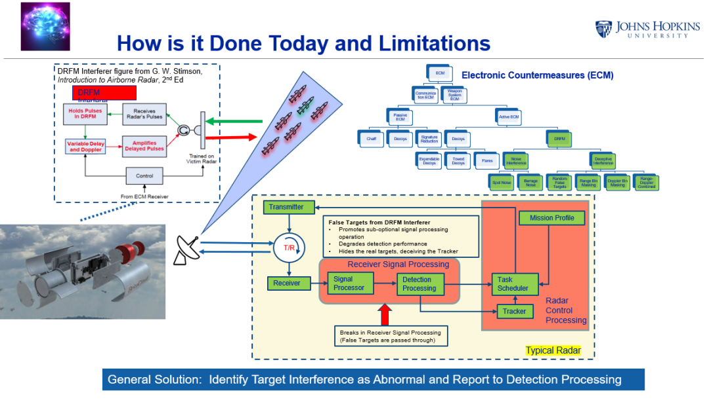
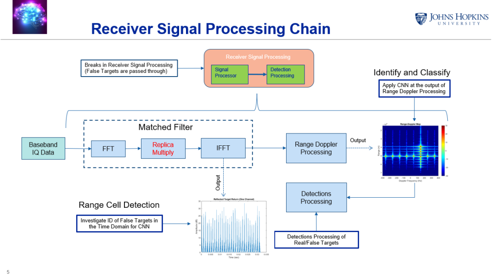
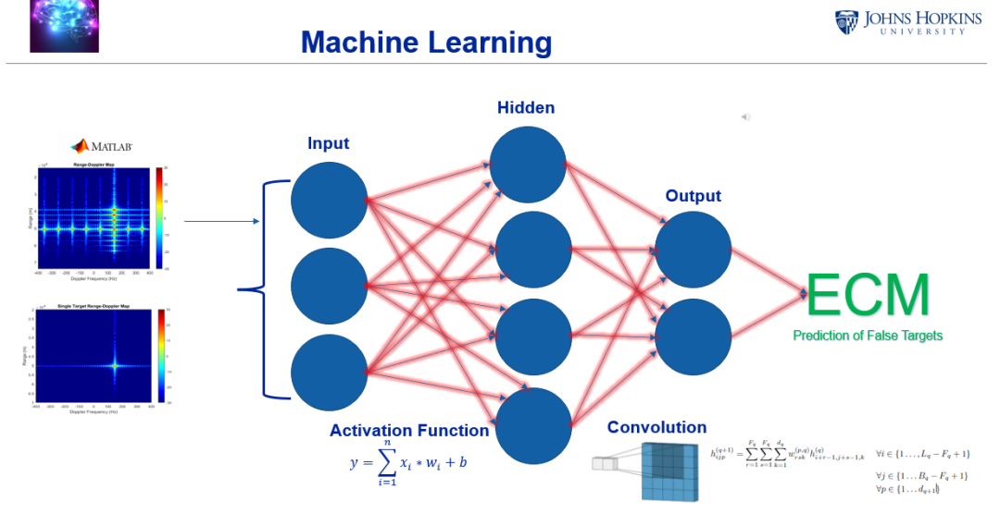
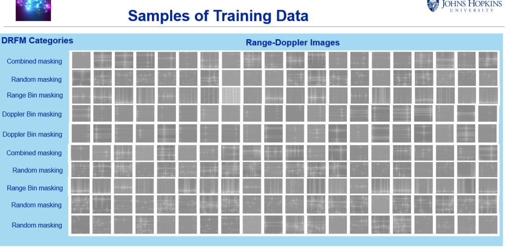
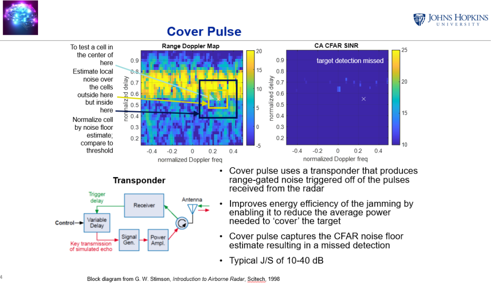
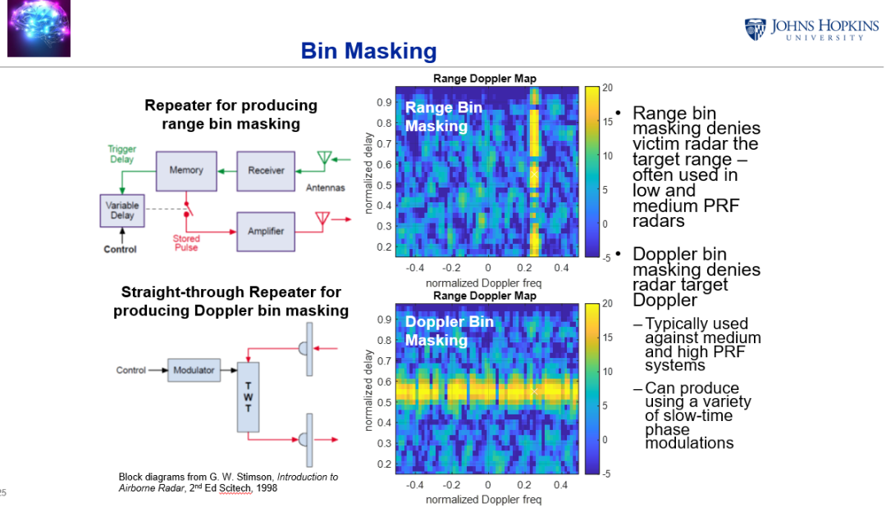
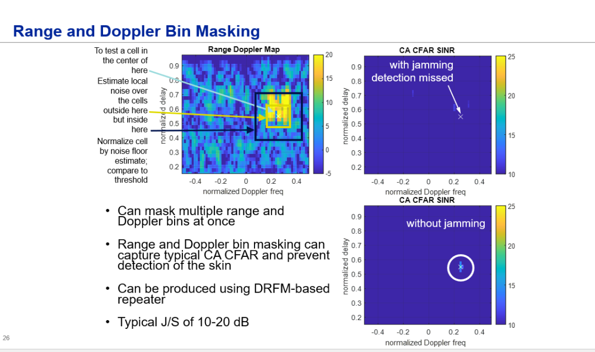
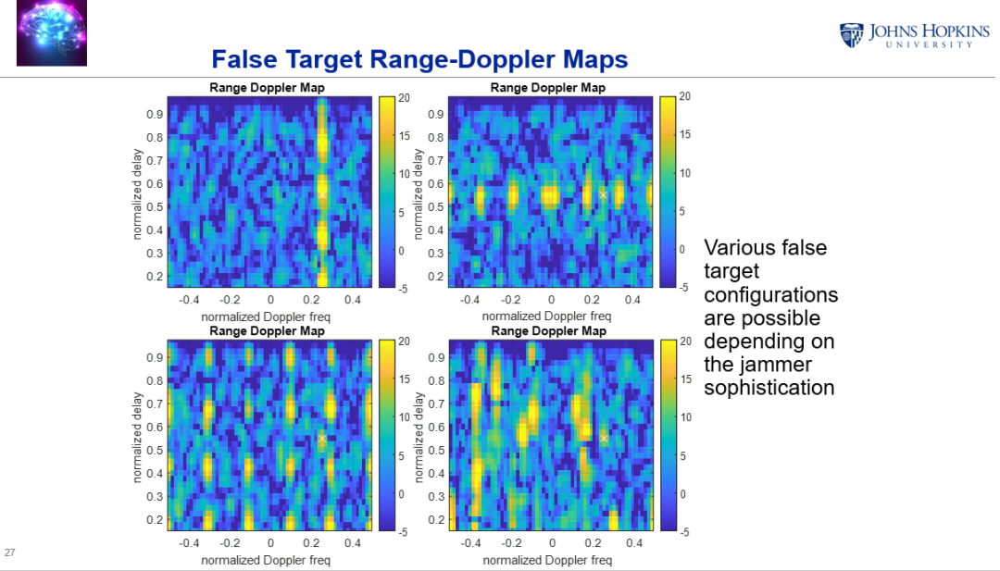
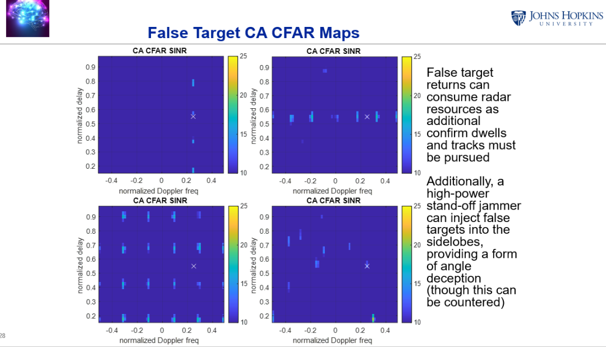
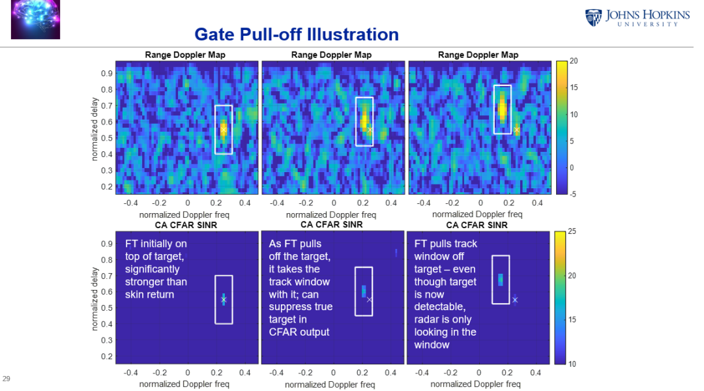
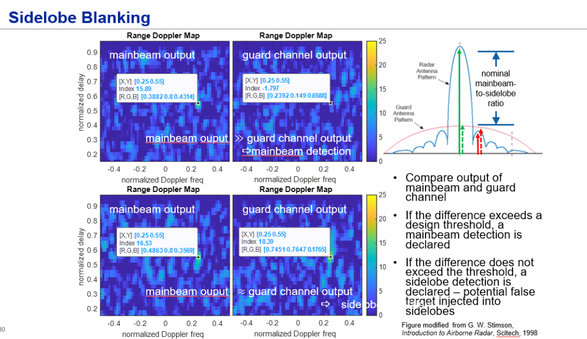

<!-- PAYMENT_BLOCK -->

## Get this dataset

- Payment link (Stripe): [Buy now](https://buy.stripe.com/3cs8yP7sY87d0vu9AB)
- Payment QR code: 

<!-- /PAYMENT_BLOCK -->
